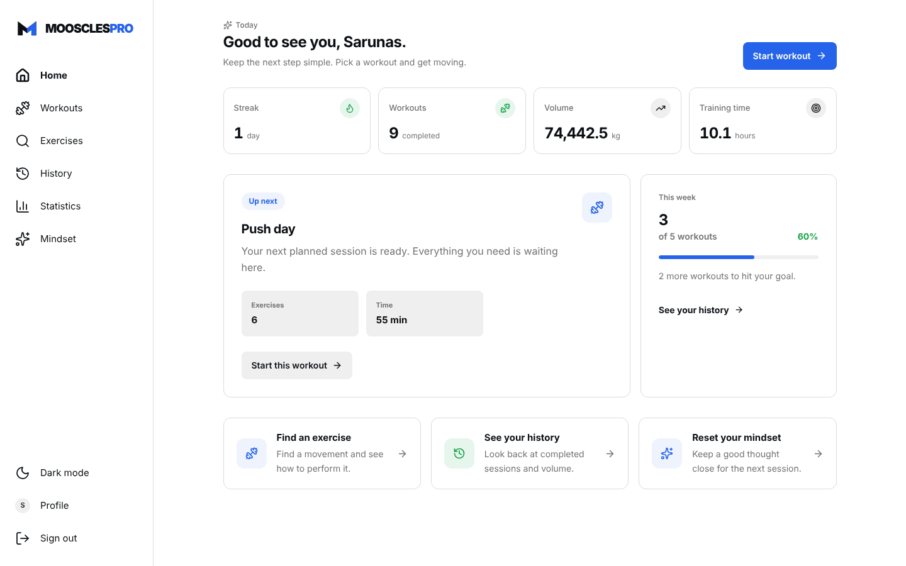
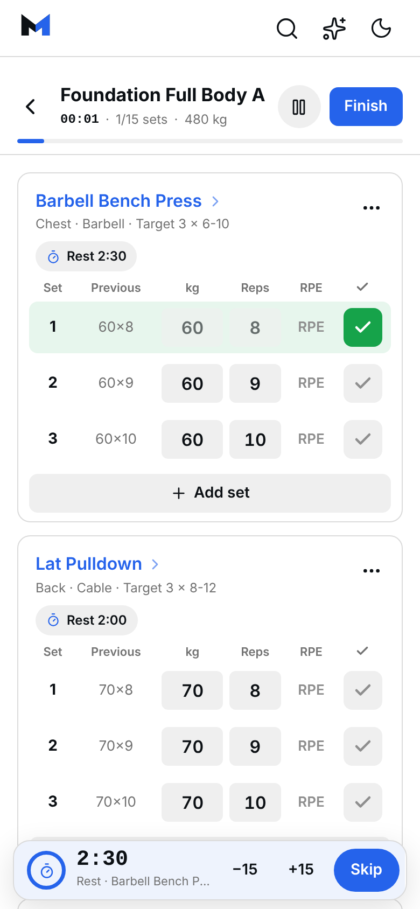
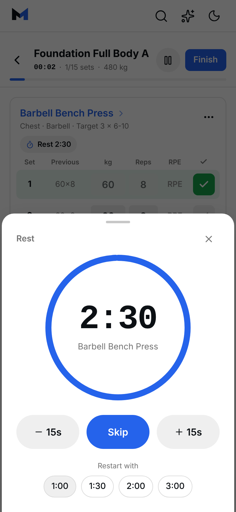
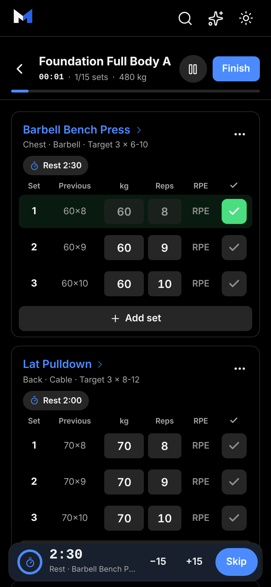

# MoosclesPro

**Live app: [mooscles-pro.vercel.app](https://mooscles-pro.vercel.app/)**

A workout tracker built around one simple loop:

**plan a workout → log every set → finish the session → learn from the history.**



| Logging a workout | Rest timer | Dark mode |
| --- | --- | --- |
|  |  |  |

More screenshots: [workout on desktop](screenshots/workout.png) · [routines](screenshots/workouts.png) · [statistics](screenshots/statistics.png) · [history](screenshots/history.png)

## Product

- Dashboard with current training overview
- Reusable workout routines and ready-made programs
- Set-by-set logging for weight, reps, RPE and completion, with every exercise on one screen
- A "Previous" column showing last time's sets (tap to copy them)
- Rest timer per exercise, adjustable mid-workout and remembered for next time (premade routines too)
- Rest timer that keeps counting through refreshes and a locked phone, with sound and vibration at the end
- Skip an exercise or add and remove sets during a workout
- Celebrations for new personal records and finished workouts
- Resumable active workouts stored locally
- Completed workout history and session details
- Training statistics, volume and streaks
- Exercise library with search and filters
- Light and dark themes
- Responsive desktop and mobile layouts
- Session-based authentication and user-scoped MongoDB data

## Tests

The workout logic is covered by unit tests written with **Vitest**. They run on GitHub Actions on every push.

### What the tests cover
- **Statistics:** volume and counts only include completed sets and sessions.
- **Workout engine:** creating workouts, pre-filling from last time, adding/removing/skipping sets and exercises, per-exercise rest.
- **Saving:** server validation of sets (RPE range, pound weights, impossible numbers) and that only known fields are stored.
- **Rest timer:** countdown from an end time, ±15 s adjustments, and edge cases.

Run them locally:
```bash
npm run test
```

## Architecture

- **React + TypeScript + Vite** — browser application
- **Tailwind CSS** — shared responsive design system
- **Zustand** — active workout client state
- **Vercel Web API handlers** — HTTP/server boundary
- **Better Auth** — authentication and sessions
- **MongoDB Atlas** — accounts, routines and completed workout sessions

### Request and data flow

The browser talks to same-origin `/api/*` handlers. Better Auth reads and writes its users and sessions through the MongoDB adapter. Every routine and workout-session handler derives the owner from the authenticated Better Auth session; it does not trust a `userId` supplied by the browser. The dashboard and statistics handlers use the same user-scoped session query and compute their metrics from completed sets.

### Data model

| Collection | Purpose | Ownership and important fields |
| --- | --- | --- |
| Better Auth users and sessions | Account identity and persisted sign-in | Better Auth managed; sessions expire according to auth configuration |
| `routines` | Reusable user workout plans | `userId`, `id`, `name`, ordered exercises, `updatedAt` |
| `workoutSessions` | Completed workout history | `userId`, `routineId`, start and completion timestamps, exercises, sets, weight and reps |

Weights are stored in kilograms. The selected kg/lb preference is a display and input conversion preference, so changing units does not rewrite saved sessions. A session counts as a completed workout only when it has valid timestamps and at least one completed set. Volume is the sum of `weight × reps` for completed sets; duration comes from the session start and completion timestamps.

## Two-minute demonstration

1. Register a new account, sign out, then sign back in to show that the session persists across navigation and refresh.
2. Create a routine, add a few exercises, and reorder or edit them.
3. Start that routine, enter weights and reps, complete sets, and use the rest timer.
4. Finish the workout, open History, and confirm the routine, sets, volume, and duration were saved.
5. Return to the dashboard and Statistics and confirm their totals match the saved history. Switch to another account to demonstrate private data separation.

## Demo account (optional)

To let visitors look around without registering, create an account in the app, then set `VITE_DEMO_EMAIL` and `VITE_DEMO_PASSWORD` (see `.env.example`). The sign-in page then shows a "Try the demo account" button. Without those values the button is hidden.
